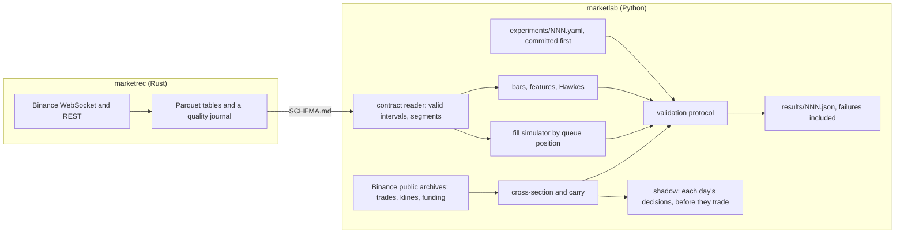

# marketlab

**A research lab for crypto markets in which every hypothesis is committed before its data
is read, and judged once on days it has never seen.**

[](https://github.com/nathaniel-brodetsky/marketlab/actions/workflows/ci.yml)


From order books recorded tick by tick by
[marketrec](https://github.com/nathaniel-brodetsky/marketrec) to the funding of 678
perpetuals over seven years:
microstructure features, a fill simulator by queue position, Hawkes processes,
cross-sectional rules on Binance's public archives, and one validation protocol for all of
them. A hypothesis that failed stays in `results/` next to the ones that passed. This file
describes only what is implemented and tested; every number in it is a backtest, and says
on which days.

## At a glance

| | |
|---|---|
| **The rule** | a hypothesis is a YAML file committed before its first run; the runner refuses anything else and writes the commit into the result. Its held-out days are opened once, and a second time is refused. |
| **The protocol** | purged and combinatorial cross-validation, at least 200 surrogates of each of three kinds, Benjamini-Hochberg over every hypothesis ever written (unrun ones at p = 1), the probability of backtest overfitting, the deflated Sharpe ratio against every rule looked at first. |
| **Costs** | every trading rule through a fill simulator by queue position, judged in its pessimistic mode, or at a futures taker's 9 bp a round trip and the funding as settled. |
| **Found** | order flow forecasts the next second and volatility the size of the next moves, out of sample; neither pays its fees. Funding carry pays after them: spot against perpetual at about the rate of Treasury bills since 2022, carry across coins more, but not yet distinguishably from noise. |
| **Running** | carry across coins traded three ways (as it is, with a stop on each position, and split among the hours after each funding settlement), tested forward on days that do not exist yet (2026-12-01 .. 2028-11-30), its decisions recorded every day before they would trade. |
| **Checked** | a look-ahead test that cuts days at random times and finds nothing before the cut changed; 253 deliberately injected one-line faults, each caught by the tests. |

## Results so far

| | hypothesis | verdict |
|---|---|---|
| 001 | multi-level order-flow imbalance forecasts the next second | passed on development: rank IC 0.29, positive on every day |
| 002 | a maker that withdraws on order flow loses less | failed |
| 003 | Hawkes intensity forecasts volatility | failed (p 0.066 after Benjamini-Hochberg) |
| 004 | VPIN forecasts volatility | failed |
| 005 | trade flow over 100 trades forecasts the next 30 s | held out: IC 0.057, positive on all 21 days |
| 006 | 44 trade-only signals, screened as one hypothesis | 3 of 3 confirmed held out: recent volatility forecasts the size of the next 30 s |
| 007 | trade flow pays a taker's 9 bp | failed: 3.1 ± 1.0 bp at best |
| 008 | BTC spot against its perpetual, for the funding | confirmed: 6.0% a year of the notional, 2024 .. 2026 |
| 009 | funding carry across coins | confirmed at p 0.0499, then shown to be its start day's luck |
| 010 | momentum across coins | failed: PBO 0.55; held out 2024 .. 2026, not confirmed (p 0.157) |
| 011 | the carry as seven staggered portfolios | passed development; tested forward to 2028-11-30 |
| 012 | 011 with each position on isolated margin | failed on development: its liquidations cost more than its floor saved |
| 013 | 011 with each position sold once it has lost its weight | passed development; tested forward to 2028-11-30 |
| 014 | 011 with its capital split among the hour after each funding settlement | passed development; tested forward to 2028-11-30 |
| 015 | 011's shorts against the rest of the universe | written; tested forward to 2028-11-30 |

The numbers behind each verdict, and what they mean: [What has been found](#what-has-been-found).

## How it fits together



The data contract is [`SCHEMA.md`](SCHEMA.md), a copy of marketrec's, version 1. marketrec
only writes those files and marketlab only reads them; the two repositories share nothing
else.

## Contents

- **Recorded order books**: [Run](#run) · [App](#app) · [Architecture](#architecture) ·
  [Where the data can be used](#where-the-data-can-be-used) · [Bars](#bars) ·
  [Features](#features-layer-1) · [Point processes](#point-processes-layer-2) ·
  [Execution](#execution) · [Strategy](#strategy)
- **Judging a hypothesis**: [Validation protocol](#validation-protocol) ·
  [No look-ahead](#no-look-ahead) · [Numbers](#numbers) · [Limitations](#limitations) ·
  [Tests](#tests)
- **Public archives, many coins**: [Binance public archives](#binance-public-archives) ·
  [The cost wall](#where-to-look-the-cost-wall) ·
  [Many coins, a day at a time](#many-coins-a-day-at-a-time-a-rough-look)
- **Results**: [What has been found](#what-has-been-found)

## Run

```bash
python3 -m venv .venv && . .venv/bin/activate
pip install -e '.[dev]' && pytest
marketlab day data/binance/BTCUSDT/2026-11-21
```

`marketlab day` needs a day recorded by marketrec. Without one, `marketlab synth /tmp/synth`
writes a synthetic day: a toy market, consistent the way the recorder's output is, with a
hole and a late interval in it, and nothing to say about real markets.

```text
$ marketlab day /tmp/synth/binance/BTCUSDT/2026-11-21
day         /tmp/synth/binance/BTCUSDT/2026-11-21
symbol      BTCUSDT, price step 0.01, qty step 0.00001, feed json
run         synthetic, 10:00:00-10:10:00 UTC, book synced after the start, derivation 1
rows        depth_diff 23308, book_ticker 9671, trades 3647, book_l20 5892, quality 7
problems    1 gap, 1 resync
usable      592.0 s of 600.0 s from the first row to the last (98.67%), in 3 segments
excluded    5.0 s without a valid book, 3.0 s late
longest     237.0 s from 10:06:03 UTC
```

| command | what it does |
|---------|--------------|
| `marketlab day DIR` | runs, rows, the quality events that are not routine (gaps, undecodable messages, overflows), how much of the time with a connection open is usable, in how many segments, and what was left out |
| `marketlab bars DIR [--every 1s]` | time bars against tick, volume and dollar bars: return distribution and dependence |
| `marketlab features DIR [--train DIR ...] [--out FILE]` | every feature on the day, summarized; fitted features need training days |
| `marketlab execution DIR [--every 10s] [--size 0.001] [--cancel-after 10s] [--latency 300ms] [--aggressive]` | probe orders through the fill simulator in each queue mode: what became of them, fill rate, wait, markouts |
| `marketlab strategy --data ROOT [--offsets 0 1 2] [--signal 1s] [--threshold 1] [--vol-window 1m] [--vol-quantiles none 0.8] [--life 10s] [--max-position 5] [--modes ...] [--fees ...] [--by-day] [--workers N] [--out FILE]` | a market-making rule quoting both sides through the fill simulator, day by day: P&L before fees, what the fills captured against the mid and what the position lost, the maker fee at which it breaks even, net P&L at given fees |
| `marketlab experiment run SPEC --data ROOT [--workers N] [--final]` | run a committed hypothesis (of any kind below) through the protocol and write its result to `results/`; `--final` opens the held-out days, once |
| `marketlab experiment list` | every hypothesis, run or only written, with its verdict and its p-value adjusted for all of them as they stand |
| `marketlab archive check [ROOT]` | integrity of Binance trade archives downloaded with `scripts/fetch_binance.py`: missing ids and trades, times, gaps between days |
| `marketlab synth ROOT` | write a synthetic day to try the commands |

`--late` keeps the intervals in which the data arrived late (see below).

## App

```bash
pip install -e '.[app]'
streamlit run app/main.py                                   # data in ../marketrec/data
streamlit run app/main.py -- --data ~/projects/marketrec/data
```

One Streamlit application with Plotly charts, in Russian. It reads the data root (the
`--data` argument, else `MARKETLAB_DATA`, else `marketrec/data` next to this repository)
and computes nothing heavy. It has one screen so far, the market:

- a stretch of a day, 1 to 60 minutes, picked by its UTC start: the mid, the mid weighted by
  the best levels' sizes, and trades as triangles by the side that took liquidity; the
  book's 20 levels a side as a heat map over time; the spread; the depth of each side;
  and, if asked, level-1 order-flow imbalance over the last second with the next second's
  return under it;
- a replay of 10 to 120 seconds of it, a frame every 100 ms: the book as it had arrived at
  that moment, as bars by ticks from the mid, with the trades of the last 100 ms, next to
  the mid with a line at the moment; play, pause and a slider, in the browser.

Every chart shades in grey the time without a valid book and in orange the time the data
was more than a second late, so that a hole never looks like a quiet market; lines break at
holes. Long stretches are thinned to at most 1200 time bins (each shows the last book row
in it) and 30,000 trades (the largest) before drawing. A stretch is read alone: only the
parts and row groups that hold its minutes, plus two seconds either side, which the order
flow of the last second and the return of the next one need (`Day.open(..., between=)`).
The chart of order flow and returns shows what happened; whether one predicts the other is
for the experiments, with their surrogates. The screens for data quality, latency,
features, point processes, execution, regimes, dynamics and experiments come next.

## Architecture

```text
marketrec (Rust)                         marketlab (Python)
  WebSocket + REST                         io/        contract checks, valid intervals, segments
  -> frames (primary record)               bars/      time, tick, volume, dollar
  -> Parquet tables + quality journal  ->  features/  layer 1 on the grid of valid book rows
     (data/binance/<symbol>/<date>/)       execution/ queue-position fill simulator, markouts
                                           targets/   future returns and volatility
                                           validation/ splits, IC, surrogates, PBO, FDR, DSR
                                           experiment hypothesis file -> verdict
                                           experiments/ one YAML per hypothesis, committed first
                                           results/   one JSON per run, failures included
                                           registry   every method by name
                                           view/      what the app's screens show, tested
                                           app/       the Streamlit application
                                           events/    market orders as a Hawkes process
                                           volatility HAR and a feature against the next seconds
```

Prices and quantities stay integers (steps of the symbol) until a feature turns them into
a ratio or a price; every time is the recorder's receive time in nanoseconds.

## Where the data can be used

The rules come from the contract. The book is valid from a `synced` or `resync` event in
the quality journal until the next `gap`, `invalid_book`, `reconnect`, `overflow` or
`disconnected` with reason `stopped`. A connection replaced by its successor (`handover`)
leaves it valid. A run that goes on over midnight starts the day with a valid book
(`book_at_start` in the manifest), and each run's data ends with the run.

Late data (more than 1 s behind the exchange, between `late` and `on_time`, or until the
connection ends) is left out as well unless `--late` is given: the book is right there,
but it shows the market as it was seconds before, and the receive times bunch up when the
backlog arrives.

Each usable interval is a separate **segment**. Nothing reaches across a hole: a window
over the past is reported only once it lies wholly inside its segment, so after every hole
the features warm up again; a flow or a return is never taken between the last row before
a hole and the first after it; bars start again in each segment.

The usable time computed this way agrees with the recorder's own count (`synced_ns` in the
manifest) on the days in `tests/data`: two implementations of the same rules.

Checks on reading: each part's columns, schema version, table, symbol and steps against
the contract and the manifest; a part the manifest lists must exist; unfinished parts
(`.part-NNN.parquet.tmp`) are never read. A day still being written has no manifest yet; it
is read from its parts, with the book taken as unknown until the first `synced`.

## Bars

- **time**: aligned to multiples of the length, kept only where the whole bar lies in one
  segment; bars without trades are kept.
- **tick, volume, dollar**: a bar closes at the trade that brings its count of trades,
  base quantity or notional to the threshold; trades are not split, the next bar starts
  from zero, and the unfinished last bar of a segment is dropped.

A bar's price is the mid at its close from the best bid and ask, not the last trade, so the
bounce between bid and ask is not counted as a return. `marketlab bars` compares the types
on a day: standard deviation, skew, excess kurtosis, Jarque-Bera, first autocorrelation,
Ljung-Box over 10 lags and the share of zero returns, with activity thresholds found by
counting the bars they make, so that each kind gives as many bars as the time bars. (Total
volume divided by the number wanted gives too few: a large trade passes the threshold by
far and its excess leaves with it. On a recorded day that halved the volume bars.) The
claim that activity bars give returns closer to normal and less dependent is to be
measured on recorded days, not assumed.

## Features (layer 1)

All features are reported on one grid: the `book_l20` rows inside segments, about every
100 ms while the book is valid. Windows are `(t - w, t]`.

| method | columns | from | notes |
|--------|---------|------|-------|
| `book` | `mid`, `spread_ticks`, `spread_bps`, `wmid_dev_bps`, `imb_1/5/20`, `depth_<x>bp`, `reach_bid_bps`, `reach_ask_bps` | `book_l20` | depth within x bp (0.1 and 0.25 by default) is null where the 20 recorded levels do not reach that far; `reach_*` says how far they do: a median of 0.5 bp for BTCUSDT on 2026-11-01 |
| `ofi` | `ofi_<w>` | `book_ticker` | order-flow imbalance at the best level, Cont, Kukanov, Stoikov (2014), from every best-price update |
| `mlofi` | `ofi_l<m>_<w>`, `mlofi_<w>` | `book_l20` | per-level OFI and their combination with least-squares weights fitted on training days, Xu, Gould, Howison (2019) |
| `trades` | `trade_imb_<w>`, `volume_<w>` | `trades` | aggressive buying minus selling; the aggressor's side is exact |
| `vpin` | `vpin` | `trades` | Easley, Lopez de Prado, O'Hara (2012); bucket size fitted on training days |
| `intensity` | `trade_rate_<w>`, `ticker_rate_<w>`, `book_rate_<w>` | `trades`, `book_ticker` | events per second; book updates counted by how far the update ID moves |
| `cancels` | `cancel_share_<w>` | `book_l20`, `trades` | share of the quantity that left a level without a trade at its price to explain it |
| `vol` | `rv_<w>`, `range_<w>` | `book_l20` | realized volatility and range of the mid, in bp |
| `microprice` | `microprice`, `microprice_dev_bps` | `book_l20` | Stoikov (2018), fitted on training days |

Every method has `fit(train_days)` and `transform(day)`. A method is one class and one line
in `marketlab/registry.py`; the tests then cover it.

## Point processes (layer 2)

`marketlab/events/hawkes.py`: aggressive buying and selling as a two-dimensional Hawkes
process with an exponential kernel, each market order raising for a while the chance of
the next ones on both sides:

    lambda_i(t) = mu_i + sum_j alpha_ij beta sum_{t_k^j < t} exp(-beta (t - t_k^j))

- Events are market orders, not trades: trades with one exchange time and one aggressor
  side are one order sweeping several levels, and counting them apart would plant
  simultaneous events the model cannot have.
- Maximum likelihood on a window, written out with its gradient in one pass over the
  events (numba): the decayed sums S_j and their derivatives in beta D_j are carried
  forward, D_j(t + dt) = exp(-beta dt) (D_j(t) + dt S_j(t)). Parameters on the log scale,
  L-BFGS-B. The tests compare the likelihood and the gradient with direct double sums and
  finite differences, and recover the parameters of simulated data (Ogata's thinning).
- The branching ratio is the spectral radius of alpha: the share of orders caused by
  earlier ones.
- The time-rescaling check: between a side's events the compensator grows by an
  exponential with mean 1 if the model is right; each window gets a Kolmogorov-Smirnov
  p-value per side, and the share of windows that pass is reported. On simulated data the
  right model passes and a Poisson model of the same events fails.
- Rolling: a fit every `step` on the `window` of events before it, only where the window
  lies inside one valid interval; the intensity at a time comes from the last fit made at
  or before it, never one made later. On data with the rates of a BTCUSDT day (27 market
  orders a second) a day of fits every 5 minutes on 10-minute windows takes seconds.

## Execution

**This simulator cannot be calibrated against reality**: there are no fills of our own to
compare it with. It is conservative by construction instead: conclusions come from the
pessimistic queue mode, a passive order fills only when recorded trades reach it, and
nothing is assumed about the book beyond the recorded levels. Our orders also change
nothing in the recorded market: no one reacts to them, and the liquidity a market order
takes is there again for the next one.

Every time is the recorder's receive time. `latency` is how long after a decision an order
takes effect on that clock: half a round trip to reach the exchange, then one feed lag
until what happened there is received, so latency = RTT / 2 + lag. `marketlab execution`
takes both medians from the day's manifest unless `--latency` is given. A cancel takes the
same time, so an order can fill while its cancel is on the way.

- **Market orders** take liquidity from the book seen when they arrive, level by level;
  the book is the last `book_l20` row with the depth updates received after it applied.
- **Passive orders** are post-only: one that would cross the book when it arrives is
  rejected. Otherwise it joins the end of its price level's queue, behind the level's
  quantity less the trades at that price already received that the book does not show
  yet. A trade at its price that hits its side uses up the quantity ahead, then fills the
  order; a trade at a worse price means the level was taken out and fills it whole.
  Quantity added to the level joins behind it.
- **A price deeper than the book shows** (past its 20 levels, with no depth update there
  since the snapshot) has a queue that cannot be known: the outcome is `unknown`. Asked
  to (`unseen="behind"`, as `marketlab strategy` does), the order rests anyway behind
  everything there: trades at its price do not reach it until a depth update shows the
  level, and all of that level is taken to be ahead of it, in every mode. A trade at a
  worse price still fills it.
- **Cancels in the queue.** When a depth update shows the level smaller than the trades
  since the last update explain, the rest was cancelled, ahead of the order or behind it:
  the data cannot say. `pessimistic`: all behind; `proportional`: the share ahead is the
  share of the level ahead of the order; `optimistic`: all ahead. In every mode no more can
  be ahead than the level holds.
- Trades are matched to depth updates by exchange time, so a trade received just after the
  depth update it is part of is neither counted twice nor taken for a cancel. This uses a
  trade received after the update to reconstruct what the exchange had already done; it
  never feeds a decision.
- **Markouts**: for each fill, the mid's change after 100 ms, 1 s and 10 s relative to the
  fill price, in basis points, signed so that positive is good for us. A passive fill
  starts with half the spread in its favour; a negative markout is adverse selection. Not
  computed when the horizon falls outside the fill's segment.

Outcomes: `filled`, `partial` (part filled, the rest cancelled), `cancelled`, `rejected`,
`unknown` (the queue at the price could not be known), `hole` (the segment ended while the
order rested), `open` (still resting when the data ends). Fill rates count only the first
three.

`tests/test_execution.py` builds queues by hand where the answer is known: trades using up
the queue, cancels in each mode, the cap at the level, a trade through the price, a fill
while the cancel is on the way, trades seen before arrival, a trade received after its
depth update, a crossing order, a level the book does not show, a hole, the end of the data, a market order walking the
book, signed markouts and markouts stopped by a hole.

## Strategy

`marketlab strategy` (`marketlab/strategy.py`) runs a market-making rule through the
simulator above, one day at a time, and answers one question: at what maker fee would it
break even?

- One post-only order of `--size` on each side at the best price, or, with `--offsets`,
  that many basis points from the mid (rounded away from it, never inside the best
  prices); each offset is a run of its own. An order rests until it fills or for
  `--life`; the next is priced from the best prices of the moment the last one's outcome
  is known: its last fill, its cancel taking effect, its arrival if it was rejected.
- The position is limited to `--max-position` orders either way; at the limit only the
  side that reduces it is quoted.
- With `--signal W`, an order is withdrawn, and none is placed, while the level-1
  order-flow imbalance over `W`, divided by its spread over the hour before (hypothesis
  002), points against its side beyond `--threshold`.
- With `--vol-window W`, a volatility gate: on both sides an order is withdrawn, and none
  is placed, while the realized volatility of the trade price over `W` (one-second log
  changes of the last trade price) is above its quantile over the `--vol-lookback` before
  (default 60m), not counting the second compared. `--vol-quantiles` takes several, a run
  each, and `none` for a run without the gate: `--vol-window 1m --vol-quantiles none 0.5
  0.8`. Where the gate is not defined (until the window and half the lookback fit in a
  segment), orders go out as without it. Hypothesis 006 found this volatility to forecast
  the size of the next 30 s move, not its direction; the gate tests whether a maker gains
  by stepping aside then.
- A day starts flat; what is held at its end is valued at its last mid.

Each order goes through the simulator alone, so the market does not react to it (see
above), but the orders follow one another and the position ties the sides together: a
decision sees only the fills received by its time. Gross P&L splits into `captured`, each
fill against the mid at its time, and `inventory`, what the position then made or lost.
The break-even fee is gross P&L per traded notional, in basis points: a maker fee below it
leaves a profit, a negative one is a rebate. Conclusions from the pessimistic queue;
`--modes` shows the others for sensitivity. An order away from the best prices may rest at
a level the book does not show; it then waits behind all of it (see Execution), and
`unseen` reports the share of such orders. The command prints one row per offset, gate
and queue mode, then net P&L a day at each of `--fees`; `--by-day` adds a table of the days
for each run.

What it gave on the 21 free days of Tardis.dev's recording of BTCUSDT (the first of each
month, 2025-03-01 .. 2026-11-01), 0.001 a side, life 10 s, at most five orders held,
latency 300 ms unless said: a backtest, and exploration, not a hypothesis written before
it was run.

| rule | break-even maker fee, bp (mean of days, standard error) |
|------|------|
| at the best prices, pessimistic queue | -1.417 (0.021) |
| the same, proportional queue | -1.334 (0.019) |
| the same, optimistic queue | -1.044 (0.022) |
| latency 5 ms / 50 ms | -1.431 / -1.417 (0.019) |
| OFI over 1 s beyond 1 | -1.428 (0.023) |
| volatility gate over 1 m, quantile 0.5 / 0.8 of the hour before | -1.452 (0.034) / -1.433 (0.022) |
| 0.5 / 1 / 2 bp from the mid | -1.402 (0.033) / -1.340 (0.043) / -1.208 (0.096) |

No rule made money on a single day before fees. Almost all of the loss is what the
position lost after its fills (`inventory`, about -1.3 bp of the traded notional in every
rule): the price went on through the level that filled the order. The orders the gate
kept out, in the busiest minutes, lost at the same rate as those it let through, so the
gate traded less, not better. Orders away from the mid rested mostly at levels the book did
not show (`unseen` 0.48, 0.85, 0.98), behind all of them, so those three rows are the
pessimistic side; the gap between the queue modes at the best prices, 0.38 bp, is a guide
to how far they may be. At a positive maker fee, the rule loses.

`tests/test_strategy.py`: every order's fills are what the simulator gives it alone, at
the price the rule gives from the best prices last seen, at them and away from them; the
position never passes its limit and every decision knew it; the accounts add up; a day in
pieces equals the whole day, also for orders resting long past their piece and for fills
taken while a slow line carries the cancel; a day cut
short changes no decision before the cut; the signal, the gate and both together keep
orders out while against them and withdraw them at the first row against; the gate worked
out by hand, high only above its limit, reading no trade after its time; a threshold no
value reaches is no signal, and a gate never defined is no gate.

## Validation protocol

A result counts only if it passes all six steps, the same for every method, so results can
be compared with each other.

1. **The hypothesis before the run.** `experiments/NNN-name.yaml` fixes the data, the
   feature and its parameters, the target and horizon, the variants, the protocol's
   settings and the bar to clear. `marketlab experiment run` refuses a file that is not
   committed or has changed since its commit, and writes the file's commit and the code's
   commit into the result; code with uncommitted changes is allowed but recorded.
2. **Splits by time.** Out-of-sample predictions come from purged k-fold over days: a
   training sample whose span (from the start of its feature window to the end of its
   target) meets a test day's span, widened by the embargo, is dropped. The estimate is a
   distribution over the paths of combinatorial purged cross-validation, not one number.
   The last days are held out; `--final` opens them once and a second time is refused.
3. **Surrogate data.** The out-of-sample prediction and the target are misaligned three
   ways, at least 200 times each: minute blocks of the prediction shuffled, the prediction
   replaced by an IAAFT surrogate of itself (same values, nearly the same spectrum), the
   target shifted by at least ten horizons. The real IC must beat the 95th percentile of
   each. The random numbers depend only on the seed, so the surrogates come out the same
   on any number of processes.
4. **Multiple tests.** Benjamini-Hochberg over every hypothesis in `results/`, failed ones
   included, and every one written in `experiments/` but not run yet, at p = 1: a verdict
   cannot gain from being run before the others. The probability of backtest overfitting
   (CSCV) over the hypothesis's variants; the deflated Sharpe ratio for trading rules.
5. **Costs.** A trading rule is judged through the fill simulator, with the pessimistic
   queue. (No trading rule has been written down yet.)
6. **Stability.** The IC by day, by six hours of the day and by the volatility of the
   minute before: a signal that works one day in seven is not a signal.

The metric for a forecast of returns is the rank IC by day, with Newey-West standard errors
because samples overlap when the horizon is longer than their spacing; days are taken as
independent. Each run ends in `results/NNN-name.json` with one of three verdicts:
`passed`, `failed`, `insufficient data`, and the reasons. Days with fewer usable hours than
the hypothesis asks are left out and named, with their hours, so that a short sample has a
visible cause.

`tests/test_validation.py` checks each statistic against an answer worked out in advance:
purging and embargo sample by sample, the CPCV paths, Newey-West against the plain error,
the IC against SciPy's Spearman, surrogates that keep the values and lose the order, PBO
of zero for a real edge and one for a trap, Benjamini-Hochberg by hand, and the deflated
Sharpe ratio paying for trials. `tests/test_experiment.py` runs the protocol on data with a
planted signal (it passes every step) and without one (it fails on the surrogates), and
checks the commit rule and the one-time held-out days.

**The first experiment** (`experiments/001-mlofi.yaml`): multi-level OFI of the last second
over the best ten levels, weights fitted on the training days, against the mid's return
over the next second; six variants for PBO; 4 of the 21 free days of Tardis.dev held out.
On the 17 development days it passed (rank IC 0.29, positive on every day, surrogates at
most 0.002, PBO 0.20); the move it forecasts is about 0.3 bp a second on average and 1 bp
at most, far below a taker's fees.

**Hypotheses about trading rules** have a `kind`. `kind: maker` (`marketlab/maker.py`)
asks whether a signal cuts what passive orders lose to adverse selection: probe orders at
the best prices go through the fill simulator once per day, and a rule withdraws an order
when the signal turns against it. Withdrawing changes nothing before it takes effect, so
every rule and every surrogate follows from that one simulation (an order withdrawn at `t`
keeps the fills received by `t + latency`; `tests/test_maker.py` checks this against the
simulator itself). The metric is the fills' quantity-weighted mean markout with the rule
minus without it, by day; with no fitted part the days are scored directly. Controls: the
signal rolled within its day by at least ten minutes (same withdrawals, wrong times), PBO
over the variants, Benjamini-Hochberg over the registry, the pessimistic queue for the
verdict and the other two for sensitivity. The report gives the mean markout with the rule
as the maker fee at which it breaks even. A day goes through the simulator an hour at a
time, with a minute of data before each hour and as much after as an order's cancel,
latency and longest markout reach: a busy day's 50 million depth updates do not fit in
memory four times over, an hour's do, and every order sees what it sees in the whole day
(the tests compare the two). `experiments/002-maker-ofi-pull.yaml` is the
first: level-1 OFI of the last second, scaled by its spread over the hour before, beyond
one unit against the order, 10-second markouts, the same held-out days as 001.

The held-out days are opened only after every hypothesis meant for them is committed, so
that none is written having seen them.

`kind: volatility` (`marketlab/volatility.py`) asks whether a feature forecasts the next
seconds' volatility better than volatility does. The target is log(0.1 bp + the mid's
realized volatility over the next 10 s), every 10 s, so targets do not overlap. Baselines,
as the specification asks: the next window as the current one, and HAR (the log realized
volatility of the last 10 s, 60 s and 300 s, by least squares). The candidate is HAR with
the feature's columns. The metric is the gain over HAR by day, 1 - MSE(candidate) /
MSE(HAR), out of sample on a purged k-fold over days; the control rolls the feature's
columns within each day by at least ten minutes and fits again.
`experiments/003-hawkes-vol.yaml`: the Hawkes log intensity, its change over the last
minute and the branching ratio, from fits every five minutes on the ten before.
`experiments/004-vpin-vol.yaml`: VPIN, with its bucket volume set from the development
days' volume, and Andersen and Bondarenko's critique written into the hypothesis: HAR
already holds recent volatility, so VPIN is expected to add nothing.

## No look-ahead

The value at time t uses only data received at or before t. `tests/test_lookahead.py` cuts
synthetic days with holes, a reconnect and late data at random times and checks that no
feature and no bar before the cut changes, for every registered method; fitted methods are
fitted once on another day. A deliberately peeking method is in the same file to show the
check fails on it. The check found one real difference: a matrix product summed in a
different order for a different number of rows, so the same row gave a value differing in
the last bits; the combination is now summed level by level.

For the simulator the same file checks that each probe decision equals the one made on the
day cut at the decision's own time, and that an order's outcome, once final, and a
markout, once its horizon has passed, do not change when the data after them is removed.
It found one real error: an order was reported as caught in a hole from the last
nanosecond of its segment, before the event that ended the segment had been received; a
hole now counts from that event.

`python scripts/mutants.py` injects 45 one-line faults one at a time (a window that reads
200 ms ahead, an interval that includes its end, a flow or a return across a hole, a VPIN
bucket that closes at the next trade, a bar that keeps its unfinished tail, an order that
arrives or cancels without latency, cancels that may push the queue past the level, trades
counted twice, a probe that prices from 300 ms ahead, a markout across a hole, and others)
and runs the tests on each: all 45 are caught. For the protocol it adds 13 more: no purging,
no embargo, every CPCV path through the same split, Newey-West without its lags, the IC on
values instead of ranks, the held-out days used in the run, a shift surrogate that does not
shift, PBO that picks with hindsight, Bonferroni in place of Benjamini-Hochberg, and others;
and one for the bars, thresholds taken from totals instead of counted: 59. The later
stages (point processes, the maker probe, the strategy and its gate, the archives, the
trade-flow, screen and edge kinds) add their own, among them a gate that counts the second
it is compared with and a taker filled with no latency; and the cross-section's, among them
coins tied on a rate ranked by rounding, a day's span an hour late, a liquidated position
bought back for free and one whose losses are forgotten the next day, a stop at the whole
weight whatever it is set to, a rule split among hours traded at the first of them only, and
a symbol in Chinese letters asked for as it is: 253 in all, each caught.

## Numbers

A day of Tardis.dev's recording of BTCUSDT (2026-11-01, imported with `marketrec import
tardis`: 10.2 million depth rows, 3.4 million best bid and ask updates, 1.1 million trades,
0.86 million book rows), on the author's laptop (Fedora, 32 threads), 2026-11-18:

| command | wall time |
|---------|-----------|
| `marketlab day DIR` | 2.0 s |
| `marketlab features DIR --train DIR` (every feature, fitted ones trained on 2026-10-01) | 16.0 s |
| `marketlab execution DIR --latency 300ms --aggressive` (17,278 orders in each of the three queue modes, and market orders) | 51.3 s |

Results of hypotheses are not here but in `results/`, written by the protocol.

`python scripts/timing.py` gives a rough size of the work: a synthetic hour with the rates
of a recorded BTCUSDT hour (about 436 thousand best-price updates, 165 thousand trades,
36 thousand book rows). On the development container all features took 0.6 s, the bar
comparison 0.2 s, and 2,880 simulated orders (one per side every 10 s in three queue modes,
plus market orders) 3.2 s. The market there is a toy, so this is not a result.

## Limitations

- **Twenty levels every 100 ms.** The tables keep the top 20 levels only at those times.
  For BTCUSDT that is cents, a few hundredths of a basis point, so depth bands are small
  and `reach_*` shows it; multi-level OFI and cancel share see only changes that survive
  100 ms.
- **Cancel share is an estimate.** Aggregated L2 data cannot tell a cancel from a fill;
  fills are taken from trades at the level's price, and a level that leaves the top 20
  without crossing the best price may only have been pushed down, so it is not counted.
- **VPIN** uses 1000 buckets a day over 50 by default, so its first value comes about an
  hour into a segment. The paper's 50 over 50 needs a day of unbroken data, and on a
  quieter day than the training ones gives none: so it was on 2026-11-01.
  It goes through the same tests as any feature: Andersen and Bondarenko found its
  forecasting power for volatility comes from its link to volume.
- **Days are read one at a time.** A segment ends at midnight even when the recording goes
  on, so windows warm up again after it. Reading consecutive days as one is next.
- **Fitted methods need training days.** `marketlab features` skips them without
  `--train`; fitting on the day being described would leak.
- **Receive time.** Every time is the recording machine's; the lag behind the exchange is
  in the manifest, measured with that machine's clock.
- **The simulator sees the book in 100 ms steps.** Depth updates come every 100 ms, so the
  queue at arrival and the cancels are known at that resolution; trades are exact.
- **Memory.** The simulator holds a day's depth updates in memory: for BTCUSDT that is tens
  of millions of rows, a gigabyte or two. Reading them hour by hour is next.
- **The surrogates test the alignment, not the fit.** Multi-level OFI is fitted on the mid's
  change over the same window, not on the target, so the surrogates misalign the finished
  out-of-sample prediction with the target instead of refitting on each surrogate.
- **Days as independent units.** The recorded days are a month apart, so purging and the
  embargo remove nothing between them; they matter once consecutive days are recorded.
- **Experiment files** take `mlofi` as the feature and `return` as the target so far; other
  methods are added to the runner as they get experiments.

## Binance public archives

`python scripts/fetch_binance.py --start 2026-09-01 --end 2026-11-18` downloads Binance's
daily trade archives from data.binance.vision (`aggTrades` by default, or `--kind trades`;
spot, or `--market um`/`cm` futures) into `binance-data/`, each file checked against the
SHA-256 checksum Binance publishes beside it. Run again, it fetches only what is missing
or failed its check; a day not published yet is skipped. Standard library only, so it runs
on any machine with Python 3.9 or newer. The archives hold trades without the order book:
enough for hypotheses on trades alone (intensity, VPIN, volatility, trade clocks), not for
order-flow imbalance or the fill simulator. Spot timestamps are in microseconds from
2025-01-01, in milliseconds before. `--kind klines --interval 1h --monthly` fetches price
bars a month a file (`binance-data/<market>/klines/<SYMBOL>/1h/`).

`python scripts/fetch_funding.py --start 2019-09-01 --end 2026-10-31` writes the funding
history of a USD-M perpetual to `binance-data/um/fundingRate/<SYMBOL>/<SYMBOL>-fundingRate.csv`,
from Binance's public market-data endpoint `/fapi/v1/fundingRate` (no key, no account), a
thousand settlements a request; run again, it asks only for what comes after its last row.
`tests/test_fetch.py` runs both scripts against a local server.

`marketlab archive check [binance-data]` then checks the downloaded days before any
research touches them, without looking at returns: aggregate ids that skip, raw trade ids
an aggregate range does not reach, times out of order or outside their day, empty rows,
the longest silence, dates missing from the range and ids that do not continue from one
day to the next. Exit code 1 when anything is wrong. `marketlab/archive.py` reads the zips
(with or without a header line, either time unit) into frames with times in nanoseconds.

### Hypotheses on the archives: `kind: tradeflow`

`experiments/005-tradeflow-100t.yaml` is the first: does signed taker volume, aggressive
buys minus sells over the last 100 aggregate trades, forecast the trade price's return over
the next 30 seconds? `marketlab experiment run experiments/005-tradeflow-100t.yaml --data
binance-data` runs it on the development days the spec names; `--final` opens its held-out
days, once. The windows are counts of aggregate trades (`100t`) or times (`5s`); the grid
is every `sampling` between each day's first and last trade. The feature has no fitted
parameters and a sign fixed by the hypothesis, so every development day is out of sample
for it; the choice between windows is what PBO measures. Otherwise the protocol is the
forecast one: rank IC by day with Newey-West errors inside the day, three kinds of
surrogates, Benjamini-Hochberg over every hypothesis written, stability by time of day and
by the last minute's move. `tests/test_tradeflow.py` works the flow and the target out by
hand, cuts a day to show the flow reads nothing after its time, and finds a planted effect
and not its absence.

### Many signals as one hypothesis: `kind: screen`

`experiments/006-screen-trades.yaml` tries 44 combinations of a trade-only signal and a
target at once (signed volume and order count, size skew; trade intensity, volume rate,
realized volatility, Hawkes intensity; returns and their size over 5 s to 5 min) and
counts them as one hypothesis. The development run scores every combination, measures
PBO over the whole grid, and applies the rule written in the spec blindly: the best by
mean IC that are positive on enough days and beat their surrogates, until it has the
number it should take. Its verdict is then `screened` (or `failed`); the claim itself is
decided by `--final`, which scores only the chosen ones on the held-out days, once, with
Benjamini-Hochberg over them. Until then the screen counts at p = 1 in the family.
`tests/test_screen.py` works every signal out by hand, cuts days to show none reads a
trade after its time (Hawkes included), takes a planted signal, refuses noise, and passes
over a signal its surrogates refuse.

`marketlab experiment list` shows, for each hypothesis, what its held-out days said:
`confirmed k/n` for a screen or an edge, `opened` for the others, `-` before.

### Does it pay what it costs: `kind: edge`

A forecast can be real and still too small to trade. `experiments/007-flow-beats-cost.yaml`
asks whether the signed flow points to moves larger than what a taker pays for them. The
rule: at each time of the 5 s grid, with no position open, buy if the flow is above its
95th percentile over the two hours before, sell if below its 5th; filled at the last
trade price 300 ms later, closed at the last trade price a horizon later (1 to 60 min),
one position at a time, none that would close after midnight. The mean over days of each
day's mean signed return is the round-trip cost at which the rule breaks even, and the
hypothesis names the cost it must beat: 9 bp, two taker fees of a regular Binance USD-M
futures account paying in BNB. The development run scores all 32 combinations of flow and
horizon, measures PBO over them, and takes, blindly, the one with the strongest evidence of
beating the cost (the smallest one-sided p of its mean against it), if it beats the cost on
enough days and its surrogates (the flow moved in time within its day by a random offset).
Only that one goes to the held-out days, eight months of 2026 that no trade signal has read
yet (less the first of each month, read before as Tardis.dev's spot days); if none is
taken, they stay closed. `tests/test_edge.py` works the returns and the rule out by hand,
cuts days to show no decision reads a trade after its time, finds a planted edge, does not
find one where there is none or where the cost is above it, and passes over a combination
its surrogates refuse.

### Funding carry: `kind: carry`

`experiments/008-funding-carry.yaml` leaves the short horizons: it holds BTC on spot
against an equal short in the perpetual and collects the funding, a position held for days
so that its fees, 24 bp in and out at a regular account's taker rates, are spread over many
settlements. The rule decides only at a settlement: hold over the next period while the
mean rate of the last 21 settlements is above zero, opening and closing at the open of the
hour bar that starts then. The return, in bp of the notional at the start of each period,
is the funding received (at Binance's mark price), the change of the basis between the two
legs, and the fees; by UTC day, tested for a mean above zero with Newey-West errors, PBO
over twelve rules by month, Benjamini-Hochberg over every hypothesis written. Development
January 2020 .. December 2023; held out, once, January 2024 .. October 2026. Sharpe ratios
are from monthly sums: daily ones overstate it, the funding staying high or low for months.

`marketlab carry-report SPEC --data binance-data --riskfree binance-data/fred/GS3M.csv`
describes a carry once its verdict is recorded, the held-out period only once it has been
opened: by year, the primary rule and holding always in % a year of the notional; the
three-month Treasury bill's rate (`scripts/fetch_fred.py` downloads FRED's GS3M); the
primary's return on the capital it needs, the spot leg and the short's margin at
`--leverage`, and that over the bills; Sharpe from months, also over the bills; the worst
months; and the largest rise of the perpetual within 8 h, a day and a week while the
position was held, with the leverage at which the short leg survives it if its margin is
topped up that often. Not modelled: the exchange's own risk, auto-deleveraging, slippage,
and the moving of margin between the legs.
`tests/test_carry.py` reads the archives in either time unit, works the money of a rule
out by hand, holds a year while the price triples, shows no decision changes with what
comes after it, finds a planted carry and none where the rate averages nil, opens the
held-out period once, and works the report's capital, bills, highs and rises out by hand.

### Funding carry across coins: `kind: xsection`

`experiments/009-xsection-carry.yaml` writes down the rule the rough look below (`marketlab
xsection`) found steadiest, before its held-out years are read: each UTC day the 50
perpetuals on coins with the most quote volume over 30 days, long those whose funding over
the last 7 days was lowest (strictly the bottom 20%), short the highest, half the capital a
side, rebalanced every 7 days at the daily close, 9 bp a round trip, the funding in the P&L.
The daily net, in bp of the capital, is tested for a mean above zero with Newey-West
errors; Benjamini-Hochberg over every hypothesis written, PBO against the daily rebalance,
months up, and the deflated Sharpe ratio against the seven rules the rough look reported
(reported, not a bar: the rule was chosen among them on these days, so they cannot test it
fairly). The development years were looked at first, so the test is the held-out period,
January 2024 .. October 2026, opened once with `--final`: confirmed if its mean is above
zero at 5% one-sided, it was up in at least two of its three years, and its beta to the
universe (equal weights) is within 0.3. Nothing but that run reads a day after 2023-12-31.
A rule may be traded `hours` after the daily close (from the hourly bars, as `marketlab
xsection --hours` does); its held-out run first checks that the held-out universe has hour
bars at both ends of at least 98% of its coin-days, and otherwise stops, naming the coins
short of them, before computing or recording anything.
`experiments/010-xsection-momentum.yaml` is the second, written before either held-out run:
momentum over 7 days, rebalanced daily, traded an hour after the close (an hour one can
trade at, not the best of the hours looked at), the same universe, sides, costs, held-out
period and bars as 009.
`experiments/011-xsection-carry-forward.yaml` is 009's carry as seven staggered portfolios
(below), traded an hour after the close, tested forward: its held-out period is the two
years from 2026-12-01. `experiments/012-xsection-carry-isolated.yaml` is 011 with each
position on isolated margin of its own size (`isolated: 0.05`, `xsection.Margin`), so that
a coin squeezed against it takes that margin and nothing more: a position whose margin,
after what it has lost since its rebalance, falls to 5% of its size at the day's worst
price (the extreme of the day's 24 hour bars from its trading hour, or its close where that
is worse) is liquidated, all its margin lost, and holds nothing until its portfolio's next
rebalance, which buys it back and pays for it. Between rebalances a position is held at its
weight, as without; each staggered portfolio is margined on its own. Its decisions are
011's; the held-out run reads the hour bars for its extremes, and stops without them as a
rule traded hours after the close does. Written over the same two years as 011, it says
next to it what the floor is worth. `experiments/013-xsection-carry-stop.yaml` is 011 with a
floor that needs no margin from the exchange (`stop: 1`, `xsection.Stop`): a position whose
loss since its rebalance, its funding in, reaches its own weight at a day's trading hour is
sold there, paying for the sale, and holds nothing until its portfolio's next rebalance.
Its decisions are 011's; it was written after a rough look at nine floors and filters
(What has been found, below), all of them among its trials or named in it.
`experiments/014-xsection-carry-hours.yaml` is 011 with its capital split evenly among
trading 1, 9 and 17 hours after the close (`split: [1, 9, 17]`), an hour after each of the
three funding settlements most perpetuals have, each third held as seven staggered
portfolios: as staggering takes the weekday out of a weekly rule, the split takes out the
hour. Its held-out run checks the hour bars at each of the three hours before anything.
`experiments/015-xsection-carry-short.yaml` is 011 with its long half in every other coin
of the universe (`long: rest`, `xsection._pick`): short the coins paying the most funding,
long the rest of the 50 in equal weights, on the days 011's rule holds a coin a side. Its
idea came from years already seen (What has been found, below: 011's longs lost in price
more than the funding they were paid, its shorts made its money), and a rough look at the
development years only, written in its file, came before it. Its shorts are 011's; the
shadow records its longs. 011 to 015 are one carry traded five ways over the same two
years, and their verdicts are to be read together.
`tests/test_xsection_kind.py` passes a planted carry and confirms it once, fails one where
the funding does not last, shows the development run unchanged when the held-out prices
are, makes the same Sharpe ratio worth less against trials that differ more, trades a rule
hours after the close (and its held-out run stops without its hour bars, recording
nothing), runs a rule on isolated margin, the same as without where nothing is liquidated
and losing a squeezed short's margin where something is, and runs it all through the
command. `tests/test_xsection.py` works the hour bars' extremes and the liquidations out by
hand: a short up 150% in a day loses its margin and no more, a long halved and then down
97% within a day loses what was left, a position without hour bars is judged on its close,
a rebalance buys the liquidated back and pays for it, and seven staggered portfolios
liquidated the same day are back in one a day; and a stop: a short that loses its weight over
two days sold at the end of the second, a long that loses 99% of it kept and sold the next
day, each sale paid on its day and the rebuying at the rebalance, a stop never reached
changing nothing, and seven staggered portfolios each stopped on its own days.
`tests/test_xsection_kind.py` also splits a rule between the close and four hours after it
on days whose move is made in their first two hours: the split is the mean of the two, and
its held-out run stops at the hour whose bars are missing. A rule short against the rest:
coins tied at the short cut long with the rest, nothing on a day 011's rule would hold no
long, each staggered portfolio with the rest long, and the shadow recording 011's shorts and
the rest of the universe long.

### The shadow

`marketlab shadow SPEC ... --data binance-data --close YYYY-MM-DD` writes what each
`xsection` hypothesis's rule would hold over the day after that daily close, decided from
the data up to it and nothing later, to `shadow/<id-name>.csv` (the close, when it was
decided, when it would trade, and each coin's weight): no key, no account, no order. It
records decisions only, never what they made, since a rule tested forward is judged once,
by `--final` on its whole held-out period, and a running score invites stopping or
changing it on the way. It refuses a close that is not over (today's, UTC) and one whose
daily bars are not there (none for BTCUSDT or ETHUSDT, or for more than 5% of the
perpetuals that had one the day before), and leaves a close recorded already as it was. A
rule held for several days and not staggered rebalances on the days its held-out period's
first day sets, as its held-out run does. `--catch-up` also records every close since
the last one recorded (31 at most), each from the data up to its own close, the time it
was decided written next to it: a machine that was off catches up. `scripts/shadow_daily.sh
SPEC ...`, from cron or the systemd user timer in `scripts/systemd/` (00:10 UTC, run at the
next start if the machine was off; it records 011 and 015, whose longs differ), fetches yesterday's bars and funding (`fetch_universe.py` now refuses an
`--end` of today, whose bar Binance serves while it is still open and which would stay so)
and records the decisions. `tests/test_shadow.py` checks a decision against what the
held-out run holds the next day, also between rebalances, and that it is the same with
nothing after its close on disk; a close recorded once; the refusals; and that a staggered
rule decides the same whatever day its period began on; and days missed caught up.

## What has been found

Backtests on public data; each verdict as the protocol recorded it in `results/`.

| hypothesis | verdict | in short |
|------------|---------|----------|
| 001 multi-level OFI over 1 s | passed | |
| 002 maker withdrawing on OFI | failed | p 0.99 |
| 003 Hawkes intensity for volatility | failed | p 0.066 after Benjamini-Hochberg |
| 004 VPIN for volatility | failed | |
| 005 trade flow over 100 trades, next 30 s | passed; held out opened | IC 0.091 developing, 0.057 held out, positive on all 21 held-out days |
| 006 screen of 44 trade-only signals | screened, held out confirmed 3/3 | realized volatility over 5 and 1 min, intensity over 5 min, against the size of the next 30 s: IC 0.32 to 0.34 held out |
| 007 trade flow against a taker's 9 bp | failed on development, held-out months not opened | best 3.1 +- 1.0 bp a trade (60 min) |
| 008 funding carry, spot against the perpetual | passed, held out confirmed | 13.9% a year of the notional 2020 .. 2023 (16.6, 29.8, 2.1, 6.9 by year), 6.0% over January 2024 .. October 2026; holding always 6.9% |
| 009 funding carry across coins | passed on development (deflated Sharpe 0.50, reported); held out confirmed, p 0.0499, but by its rebalance day's luck (below) | +36.4% a year 2020 .. 2023, Sharpe from months 1.42; held out +46.7% (Sharpe 1.16, worst drawdown 50.5%), the other six days of the week from +4.7% to +56.3% |
| 010 momentum across coins, an hour after the close | failed on development: PBO 0.55 over its 3 variants; its held-out period, opened once, informs, decides nothing: not confirmed | +50.5% a year 2020 .. 2023, Sharpe from months 1.40, p after BH 0.004; held out, January 2024 .. October 2026, +33.4% a year (Sharpe from months 0.66, worst drawdown 55.6%, beta -0.01, p 0.157), by year +1.1, +51.2 and +42.2% |
| 011 funding carry across coins, staggered, an hour after the close | passed on development (PBO 0.03, deflated Sharpe 0.76, reported); held out forward, 2026-12-01 .. 2028-11-30, recorded day by day by the shadow | at the close, +29.2% a year 2020 .. 2023 (Sharpe from months 1.34), +27.4% 2024 .. 2026 (0.73, p 0.126, worst drawdown 42.5%) |
| 012 the same, each position on isolated margin | failed on development: p after Benjamini-Hochberg 0.062 (PBO 0.02, deflated Sharpe 0.54, reported); its held-out period informs, decides nothing | traded an hour after the close, +21.5% a year 2020 .. 2023, Sharpe from months 0.87, worst drawdown 28.5%, against 1.27 for 011 the same way: squeezed coins went far past their close within the day, and a position liquidated there lost what the close gave back |
| 013 as 011, each position sold once it has lost its weight | passed on development (PBO 0.04, deflated Sharpe 0.80 against 12 trials, reported); held out forward over the same two years | traded an hour after the close, +27.7% a year 2020 .. 2023 (Sharpe from months 1.28, worst drawdown 20.9%; 2022 +0.2%), against +27.4% (1.26) for 011 the same way |
| 014 as 011, its capital split among the hour after each funding settlement | passed on development (PBO 0.02, deflated Sharpe 0.90 against 13 trials, reported); held out forward over the same two years | +26.1% a year 2020 .. 2023 (Sharpe from months 1.24, worst drawdown 22.8%), against +27.4% (1.26) for 011, traded an hour after the close only |
| 015 as 011, its long half the rest of the universe | written; held out forward over the same two years | |

The order flow forecasts the next seconds and volatility forecasts the size of the next
moves, both out of sample; neither pays its fees, the maker's (Strategy above) or the
taker's (007). The carry is paid after fees, but since 2022 at about the rate of US
Treasury bills (`carry-report`), with the exchange's risk and the short leg's margin on top.

009's confirmation does not hold up. Its rule rebalances every 7 days from the period's
first day, and nothing fixed which day of the week that is; the held-out run began on a
Monday. The same rule over the same held-out period [backtest, 2024-01-01 .. 2026-10-31],
rebalanced on each of the other days: Tuesday +56.3% a year (p 0.020), Wednesday +34.9%
(0.074), Thursday +26.1% (0.161), Friday +20.5% (0.252), Saturday +6.8% (0.404), Sunday
+4.7% (0.434); rebalanced daily, which no weekday decides, +31.2% (0.145). Two days of seven
clear 5%, and the mean of the seven is +28% a year at a Sharpe ratio near 0.7 with
drawdowns near half the capital: carry across coins earned something out of sample, but
not distinguishably from noise over 34 months, and its verdict was set by the day it
happened to start on. The verdict stays as recorded; the lesson goes into the next
hypothesis: a rule held for several days is run as that many staggered portfolios, one
rebalanced each day, so that no start day decides it.

A fix of 2026-11-22: the trailing means (a coin's funding over 7 days, its volume over 30)
were differences of a running sum, whose rounding carried everything summed before it, so
that a coin's carry differed in its last bits (about 3e-17) with the first day loaded. Many
coins sit on Binance's default funding rate, tied at the 20% cut, and those bits picked
which of them got in: 011's rule at the close over 2024 .. 2026 made +28.3% a year loaded
from 2024 and +26.5% loaded from 2020 [backtest], and the shadow, loading a few weeks back,
would not have held what a final run holds. Each window is now summed on its own and carry
rounded at 1e-12, where no two rates differ: rates tied in any order tie exactly, and a tie
at the cut is left out, as the rules say. Run again on the development years: 009 passed
(PBO 0.16, deflated Sharpe 0.38), 010 failed as before (PBO 0.55), 011 passed (PBO 0.03,
deflated Sharpe 0.76, p after Benjamini-Hochberg 0.0148); 011's rule at the close, +29.2% a
year (it was +31.7%). 009's held-out record was computed before the fix and stays as it was
opened.

The carry's days, at the close [backtest]: up on 51% of them before 2024 and 52% after, a
day's mean about +0.08% in both, its spread 1.16% and then 2.11%. The same edge in twice the
noise, and the noise is a few coins squeezed: a short in MYXUSDT lost 18.6% of the capital
in a day (up 301%), a long in ALPACAUSDT made 18.7% (up 505%); without its 5 best and 5
worst coins the rule made +69% of its +80% summed over 2024 .. 2026 (counted before the
fix). Its gains came in
spells (late 2020 into 2021, November 2024 into January 2025), with years between them
nearly flat: two years forward can fall on a flat one, which is why not confirmed will mean
not shown.

What a floor and a filter would have done, before 013 was written [backtest, 011's rule an
hour after the close, Sharpe from months; 2024 .. 2026 seen, so what happened, not a test]:
isolated margin of the position's size 0.86 on the development years and 0.68 after them,
against 1.26 and 0.65 without; of 1.5, 2 and 3 times it 0.91, 1.23, 1.26 and 0.53, 0.52,
0.59, each liquidation taking that many times the weight. Sold at a loss of half the
weight, 1.16 and 0.97; of all of it, 1.27 and 0.89. Trading only when the spread between
the longs' and the shorts' funding is wide (5.6 bp of the capital a day or more), 1.41 on
the development years and 0.16 after them: their thirds of the spread paid 0.3, 9.9 and
15.0 bp a day, and after them 15.7, 0.5 and 4.7. The best filter on the years it was cut on
was the worst on the years after, which is what writing a hypothesis down first is for.
BTC's trend over 30 days split the days no better: the carry paid in both before 2024 and
lost 7.5 bp a day with BTC down after it.

The same carry on a second exchange [backtest, a rough look, not a hypothesis: Bybit's USDT
perpetuals on coins from `fetch_bybit.py`, 011's rule at the close, 2024-03-06 .. 2026-10-31,
years already seen on Binance]: +16.9% a year at 9 bp a round trip (Sharpe from months 0.46,
p 0.248, worst drawdown 55.8%), +16.4% at Bybit's taker fee of 11 bp, against +32.3% (0.84,
p 0.100, 42.5%) on Binance over the same days. Their days correlate at 0.76, and the coins
both hold rank alike by carry (0.88): one trade, not a second confirmation of it. Crossed,
Binance's picks held at Bybit's returns made +18.6% and Bybit's at Binance's +22.2%. Of the
13.7 points a year Binance's picks lose at Bybit's returns, 9.3 are coins Bybit gives no
bars for on most of the days they were held (not listed there, or under another name;
small coins shorted on Binance, SKYAI, PLAY, BULLA and AGT the largest), the rest the prices
and funding of the coins both list. By leg, the funding received was nearly the same, +59%
of the capital a year on Binance and +56% on Bybit, nearly all of it paid to the longs,
whose prices cost 64% a year on both; the shorts' prices made +39% and +26%. In those years
the carry earned as a short of the coins paying the most funding, not by the funding it
collected; and Binance's +34.5% a year before costs came from ten of the 400 coins it held
(+41.4; the other 390, -6.9), ALPACA, SIREN, GOAT, PIPPIN and RIVER the largest. What two
years forward show of 011 will turn on a few such coins.

Erratum: the comment in `experiments/007-flow-beats-cost.yaml` calls the days of
Tardis.dev's recording futures days. They are Binance spot BTCUSDT. The hypothesis is left
as committed; leaving those days out of its held-out months holds either way.

## Where to look: the cost wall

`marketlab costwall --data binance-data` asks, before any signal is built, at what horizon
one could pay for itself. A rule that trades its signal's top and bottom `q` (5% by
default) and holds for a horizon earns about `IC x sigma x phi(z_q) / q` a trade before
costs, `sigma` being the standard deviation of the return over the horizon; so a round
trip of `c` bp needs `IC = c / (sigma x phi(z_q) / q)`. The command measures `sigma` on the
data (the trade archives under an hour, hourly klines from an hour to a week) and prints
the IC needed against each of `--costs` (15 bp: a spot taker; 9: a USD-M futures taker;
3.6: USD-M maker fees alone, before the adverse selection measured in Strategy above).
Above 1, no signal can pay. Returns and signal are taken as jointly normal: a wall for
deciding where to look, not a verdict on a signal; the protocol still decides those.
`tests/test_costwall.py` works the needed IC out by hand and checks it on simulated
signals, and works out the returns on a grid of trades and between hourly closes.

## Many coins, a day at a time: a rough look

`python scripts/fetch_universe.py --start 2020-01-01 --end 2026-10-31` downloads, from
Binance's public endpoints, every USD-M perpetual quoted in USDT that Binance lists, of any
status (`binance-data/um/universe.csv`), its daily bars (`um/klines1d/<SYMBOL>.csv`) and
its funding history (as `fetch_funding.py` writes it), spacing its requests inside
Binance's limits; run again, it asks only for what is missing. It also writes every
contract quoted in USDT, perpetual or not, with the contract and underlying types Binance
gives (`um/contracts.csv`), and the underlying's type of each perpetual in `universe.csv`;
`--list-only` writes the two lists and downloads nothing else.

Binance's list keeps a perpetual for a while after it is delisted, then drops it, and its
API serves no bars for a coin's earlier listing once the coin is listed again. So
`python scripts/fetch_archive_universe.py --start 2020-01-01 --end 2026-10-31` then
fills in from the public archive (data.binance.vision): it lists the archive's USD-M
perpetuals (an S3 listing), and for those gone from Binance's list, and those listed with
days of funding and no bar, downloads the monthly daily-kline files (each checked against
its checksum) and merges them into `um/klines1d/`, a day already there kept as it is; for
the gone ones, their funding from the API or, where it serves none, from the archive's
monthly funding files. The gone ones are listed in `um/gone.csv`. Gone means in neither of
Binance's lists: the archive also keeps contracts on shares, funds, metals and companies
not yet public (AAPLUSDT, QQQUSDT, XAUUSDT, OPENAIUSDT: over two hundred, from December
2025 on), which Binance lists under other contract types, or not at all;
one in `contracts.csv` under another type, and one in no list but with a bar on the last
day the listed perpetuals have one, are left out. The listing's address
and the funding files' columns are as published when this was written; anything that does
not match is reported, not guessed at.

`python scripts/fetch_bybit.py --start 2020-01-01 --end 2026-10-31 --out bybit-data`
writes the same files from Bybit's public v5 API, so that what follows reads `--data
bybit-data` as it reads binance-data: every USDT perpetual Bybit lists, trading or closed
(Bybit keeps listing its delisted perpetuals, LUNA and FTT among them), with the type of its
underlying (`um/universe.csv`), and the closed ones on coins again (`um/gone.csv`); their
daily bars (the quote volume is Bybit's turnover) and funding history, which goes back to
2020-03-25 for BTCUSDT. The type is Bybit's own (`symbolType`): of the 1,155 listed on
2026-11-23, 248 are on shares, 62 on funds, 4 on commodities and 4 on currency pairs;
stablecoins and the ETH/BTC ratio, which Bybit types as coins, are named in the script.
A delisted perpetual Bybit serves no bars of is reported and left without a file, and it
serves those of a delisted one from 2024-02-05 on only: before that day its list holds
only the coins that survived, so a look across Bybit starts in March 2024, when the coins
delisted since have the 30 days of bars the universe asks for.

`marketlab xsection --data binance-data` then looks, cheaply, at four cross-sectional
signals: momentum over 7 and 30 days, the last day's reversal, and funding carry (minus the
mean rate of the last 7 days). Each day the universe is the 50 perpetuals with the most
quote volume over 30 days; the portfolio is long those strictly above the signal's 80th
percentile and short those strictly below its 20th (coins tied on a signal, as funding
rates often are, are not ranked by name), half the capital a side, rebalanced every 1 or 7
days, a round trip of 9 bp on every unit traded, the funding paid or received in the P&L.
It reports each signal's daily rank IC and the portfolio's gross, costs and net a year,
Sharpe from months and drawdown. It is not a hypothesis: nothing in it is written before it
runs, and it reads nothing after 2023-12-31, so that 2024 .. 2026 stay held out for the
hypothesis written about whatever it finds. The coins are the perpetuals in
`universe.csv` on an underlying Binance calls a coin, and those in `gone.csv`; without
`gone.csv` the coins gone from the list are missing, which flatters a rule that buys losers.
Any other file under `um/klines1d` is left out and named, and so are seven contracts that
are not a coin's own price: USDC, the BTC-dominance, DeFi, Bluebird and Football indices,
and two gold tokens. A settlement time given twice in a funding file stops the run (summed
twice, it would double the day's rate), and the command names the largest funding a coin
in the universe paid in one day, with how many settlements made it. A perpetual that settled funding on a day for which Binance
serves no daily bar (an earlier listing of a coin listed again, for one) is missing from
the universe on that day; the command says how many such days there are, and for which
coins. Every file is read as text and then cast, since a column whose first rows look
whole (a volume of 100, then 1.5) would otherwise fail the read.

`--explain carry:1 mom7:1` (a signal and its days between rebalances) breaks a portfolio's
P&L down: by year (with the IC), by leg into price and funding, the largest contributions
of one coin on one day, the net without the ten best of them, and the next day's mean and
median return in each fifth of the signal, which is where a rank IC and a P&L of opposite
signs part. The first run, on the coins listed in 2026 only [backtest, 2020 .. 2023]:
carry rebalanced daily +55.9% a year net, monthly Sharpe 1.83; momentum over 7 days
+49.8% with a rank IC of -0.040; the last day's reversal -27.8% with a rank IC of +0.037.
Momentum earning with a negative IC, and the reversal losing with a positive one, says the
P&L comes from the tails of the cross-section, not from its body; whether that is a few
coin-days, and how much of it the missing coins would take back, is what the breakdown and
the archive are for. With the gone coins in [backtest, 2020 .. 2023]: carry daily +46.2%
(Sharpe 1.50), carry weekly +36.4% (1.42), momentum over 7 days +57.0% (1.66), the
reversal -36.2%; without the ten best coin-days +29.1%, +20.2% and +43.1%. Carry earns
its funding steadily (+27.4% a year, both legs) and its price leg from the tails: in every
fifth of the signal the median next day is 0 bp or below while the mean rises from 1.5 to
31.9 bp; momentum's top fifth has a mean of +40.5 bp and a median of -40.5 bp. Two checks
follow the breakdown: the portfolio's beta to the universe (equal weights) and its net less
beta times it, and the same portfolio decided a day late (the day before's signal and
universe), which shows how much of it rests on trading at the very close its signal was
read at. With them in [backtest, 2020 .. 2023]: carry weekly 0.00 and +33.4% a day late,
carry daily 0.02 and +44.1%, momentum over 7 days -0.04 and +30.2% (from +56.1%): its money
is in the first day after the signal.

How much of it is in the first hours, hourly bars say. `--list-universe FILE` writes every
perpetual ever in the universe (`--list-coins FILE`, every perpetual on a coin under the
data); `python scripts/fetch_hourly.py --symbols-file FILE --start
2020-01-01 --end 2023-12-31` downloads their hourly klines from the archive (each monthly
file checked against its checksum, under `um/klines/<SYMBOL>/1h/`) for the months in which
each has daily bars; and `--hours 0 1 2 4 8 --hour-rules mom7:1 carry:7` trades each rule,
decided at the daily close as ever, that many hours later, at the open of that hour's bar,
held to the same hour after its next rebalance, the funding settled from that hour on: its
net a year, Sharpe from months, and the share of its positions with an hour bar at both
ends of the day. No hour bar after 2023-12-31 is read: a month's file after it is not
opened, and the last development day, whose trading hour falls in 2024, returns nothing.

`--staggered` runs a rule held for N days as N portfolios with an N-th of the capital
each, started on N consecutive days, so that one is rebalanced every day: once all are in,
it holds the same coins whatever day it started on (each trades on its own, so the costs
are an upper bound). A rule of a hypothesis takes `staggered: true` for the same.
`tests/test_xsection.py` works the universe, the portfolio, its costs and its funding out
by hand, finds a planted momentum and nothing where there is none, shows the held-out
years are neither asked for nor read, and that the breakdown adds up to the net and finds
a planted jump, the beta of a portfolio that only rides the market and nothing left once it
is taken out, and a one-day reversal that pays on time and costs a day late; that only the
perpetuals on coins, listed or gone, are read, and a settlement given twice is refused;
a day traded hours after the close worked out by hand, its funding from that hour on, and a
move made in the first two hours that pays at the close and costs four hours later;
`tests/test_fetch.py` runs the downloads against a local server that also answers as the
archive's S3 listing does, with contracts of other types and one still trading in it, and
hourly bars fetched only for the months with daily ones.

## Tests

```bash
pytest                     # contract, intervals, bars, features, execution, look-ahead,
                           # validation statistics, the experiment runner, the app's data
                           # (and the app itself opening, with the app extra installed)
python scripts/mutants.py  # the faults above, each must make the tests fail
ruff check . && ruff format --check .
```

`tests/data/contract` holds three small days written by marketrec itself
(see [`tests/data/README.md`](tests/data/README.md)); the reader is tested against them,
and the synthetic writer's parts against their columns.
